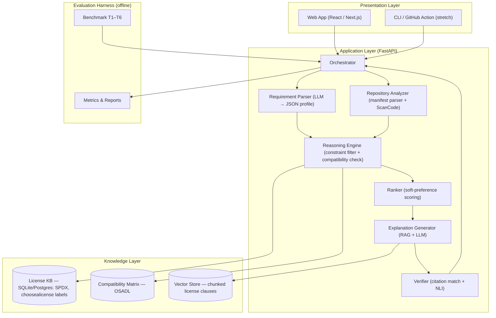

# Software Licensing Explainability with LLMs

**ENSF 621 — Project Overview (Draft)**

## 1. Motivation

Developers routinely pick an open-source license (or inherit one through dependencies) without reading it. The result is two common failures:

1. **Wrong fit:** the chosen license doesn't match what the developer actually wants (e.g., picking MIT when they wanted modifications to stay open).
2. **Incompatibility:** the project's license conflicts with a dependency's license (e.g., distributing a GPL-3.0 dependency inside an Apache-2.0-licensed product under terms that don't allow it).

Existing help is either static (choosealicense.com's short decision tree) or expensive (a lawyer). LLMs can explain legal text in plain language, but they also hallucinate, and in licensing a confident wrong answer is worse than no answer.

This project builds a tool that **recommends an open-source license for a software project and explains why**, grounding every claim in the actual license text and in machine-readable license data. Checkable facts (license attributes, compatibility) come from curated data and deterministic rules. The LLM handles understanding the developer's intent and explaining the result.

## 2. Problem Definition and Scope

Feedback from the instructor: *evaluation will be hard, we have no domain expert, so we must rely on clean public data; define and scope the problem and its location.* The scope below is set up to answer that feedback.

### 2.1 Problem statement

> Given (a) a developer's natural-language description of their goals and (b) optionally their project's dependency manifest, recommend a ranked set of open-source licenses that satisfy the stated constraints and are compatible with the dependencies, and produce a faithful, clause-cited explanation for each recommendation.

### 2.2 In scope

| Dimension | Scope |
|---|---|
| **Licenses** | OSI-approved **software** licenses catalogued by choosealicense.com (~40 licenses, including all common ones: MIT, Apache-2.0, BSD-2/3, GPL-2.0/3.0, LGPL, AGPL-3.0, MPL-2.0, EPL-2.0, Unlicense, etc.), identified by **SPDX IDs**. |
| **Artifacts** | Source-code repositories. |
| **Dependency ecosystems** | Start with **Python (PyPI)** and **JavaScript (npm)** manifests (`requirements.txt`, `pyproject.toml`, `package.json`). |
| **User** | Individual developers, students, or small teams choosing a license for a new or existing project. |
| **Output** | Ranked recommendations, compatibility warnings, and plain-language explanations that cite license clauses. |

### 2.3 Out of scope

- Legal advice. The tool explains license *text*. It does not interpret case law. A clear "not legal advice" disclaimer is part of the UI.
- Non-software licenses (Creative Commons for media, data licenses, AI-model licenses such as OpenRAIL or Llama). These are listed as future work.
- Proprietary/commercial EULAs and dual-licensing strategy.
- Jurisdiction-specific enforceability.

### 2.4 "Location": where the problem lives

- **Jurisdiction:** jurisdiction-neutral. The system reasons only about what the license text says, which is the same everywhere. Where interpretation varies by country (e.g., the public-domain dedication in the Unlicense, or the definition of "distribution"), the tool **flags the uncertainty instead of resolving it**.
- **Point in the development workflow:** (1) at **project creation** (choosing a license) and (2) at **dependency addition/audit time** (checking compatibility of an existing repo).

## 3. Objectives

**Primary objective:** design, build, and evaluate an LLM-based system that recommends open-source licenses and explains its recommendations faithfully, using only public, clean data for evaluation.

Specific objectives:

- **O1: Requirement understanding.** Convert a free-text project description into a structured constraint profile (e.g., *commercial use: allowed; modifications must be shared: yes; patent grant: required; network use counts as distribution: no*).
- **O2: Grounded recommendation.** Rank candidate licenses by how well they satisfy the profile and by compatibility with the project's dependencies, using curated license attributes and a compatibility matrix rather than the LLM's memory.
- **O3: Faithful explanation.** Generate plain-language explanations in which every claim cites a specific clause of the license text, and verify those citations automatically.
- **O4: Dependency-aware compatibility checking.** Detect licenses of declared dependencies and flag conflicts with the chosen or recommended outbound license.
- **O5: Reproducible evaluation without domain experts.** Build a benchmark from public, machine-readable sources and compare the system against rule-based and LLM-only baselines.

### Research questions

- **RQ1:** How accurately can LLMs extract license obligations (permissions, conditions, limitations) from raw license text, compared with a fine-tuned small classifier?
- **RQ2:** Does grounding (retrieval + deterministic rules) improve recommendation correctness over an LLM-only approach?
- **RQ3:** How faithful are LLM-generated license explanations, and how much does automatic citation verification reduce hallucinated claims?
- **RQ4:** How robust is the system to paraphrased requirements and to *modified* licenses (e.g., MIT plus a custom "no commercial use" clause)?

## 4. Data Sources (Clean, Public, Machine-Readable)

| Source | What it provides | Used for |
|---|---|---|
| **SPDX License List** (spdx.org, GitHub `spdx/license-list-data`) | Canonical license IDs, full texts, OSI/FSF flags, JSON format | License knowledge base, identification ground truth |
| **choosealicense.com** (GitHub `github/choosealicense.com`, `_licenses/*.txt` YAML front matter) | Per-license **permissions / conditions / limitations** labels (e.g., `commercial-use`, `disclose-source`, `same-license`, `patent-use`, `liability`) | Ground truth for obligation extraction and rule-based filtering |
| **OSADL License Compatibility Matrix** (osadl.org, JSON) | Pairwise *leading license / subordinate license* compatibility: yes / no / check dependency / unknown | Ground truth for compatibility checks |
| **ScanCode LicenseDB** (scancode-licensedb.aboutcode.org) | 2,000+ license texts with categories (permissive, copyleft, etc.) and variants | License detection, modified-license test cases |
| **deps.dev / PyPI / npm registry metadata** | Declared licenses of real packages | Real-world dependency scenarios |
| **GitHub repositories** (sampled public repos) | Real `LICENSE` files and manifests | End-to-end realistic test cases |
| **Published research datasets** (e.g., license-incompatibility datasets from the LiDetector line of work) | Labelled real-world incompatibility cases | External validation of compatibility checking, if accessible |

These sources are curated by standards bodies (SPDX, OSI, OSADL) or by GitHub, which is as close to expert labelling as we can get without a domain expert.

## 5. Evaluation Strategy

The core idea: **"recommend a license" is too subjective to evaluate directly, so we break it into subtasks that each have an objective ground truth.**

| Task | Input | Ground truth | Metrics |
|---|---|---|---|
| **T1: Obligation extraction** (RQ1) | Raw license text | choosealicense.com permission/condition/limitation labels | Per-label Precision / Recall / F1, exact-match rate |
| **T2: License identification** | License text, including lightly modified variants | SPDX ID (from SPDX/ScanCode) | Accuracy; detection rate for "this is a modified license" |
| **T3: Compatibility** | (dependency license, outbound license) pair | OSADL matrix | Accuracy, macro-F1, false-"compatible" rate (the costly error) |
| **T4: Recommendation** (RQ2) | Synthetic requirement scenario | Set of licenses that satisfy the constraints, **computed deterministically** from choosealicense labels + OSADL | Constraint-satisfaction rate, Hit@k, MRR, violation rate |
| **T5: Explanation faithfulness** (RQ3) | Generated explanation | License text itself | % claims with a valid citation; % cited spans that exist verbatim; NLI entailment rate (claim ⟸ cited clause); hallucination rate |
| **T6: Robustness** (RQ4) | Paraphrased scenarios; licenses with injected custom clauses | Same as T4 / T2 | Accuracy drop vs clean inputs |

### 5.1 Building the recommendation benchmark (T4) without experts

1. Enumerate meaningful **constraint profiles** from the choosealicense label space (e.g., {commercial use ✓, same-license ✓, network-use-is-distribution ✗, patent-use ✓}).
2. For each profile, the **gold answer set** is the licenses whose labels satisfy every constraint. This is a deterministic query, so no human judgment is involved.
3. Use an LLM to generate several **natural-language personas** per profile ("I'm building a SaaS startup and want contributors' improvements to come back to the community...").
4. **Validate** generated scenarios with a round-trip check: a second model (or a separate prompt) must recover the original profile from the text. Scenarios that fail are discarded. A manual spot-check of a random sample (~10%) by the team catches remaining errors.
5. Add **dependency context** by attaching real dependency sets sampled from PyPI/npm, which narrows the gold set further via the OSADL matrix.

### 5.2 Baselines

- **B1: Rule-based:** choosealicense.com-style decision tree over the structured profile (no LLM).
- **B2: LLM-only:** the same LLM asked directly, with no retrieval and no rules.
- **B3: LLM + RAG:** retrieval over license texts, without the deterministic filter.
- **Ours:** LLM for intent parsing + deterministic filter/ranker + RAG explanation + verifier.

Comparing B2 → B3 → Ours isolates the contribution of retrieval and of deterministic grounding.

### 5.3 Human evaluation (non-expert, lightweight)

We cannot measure legal correctness with non-experts, but we can measure **understandability and usefulness**. A small study with classmates/developers (≈10–15 participants) rates explanations (Likert: clarity, helpfulness, trust) and answers comprehension questions ("Can you use this in closed-source software?"), with correctness checked against the ground truth. Participants who read our explanation are compared with participants who read the raw license.

## 6. System Design

### 6.1 Software Architecture

A layered, service-oriented design. **Facts come from data and rules; language comes from the LLM.**



**Request flow (recommendation):**

1. User submits a free-text description (and optionally a repo URL or manifest file).
2. **Requirement Parser** (LLM, schema-constrained output) produces a structured profile of hard constraints and soft preferences, plus clarifying questions if the input is ambiguous.
3. **Repository Analyzer** extracts dependencies and their declared/detected licenses.
4. **Reasoning Engine** filters the license KB to candidates that satisfy all hard constraints and are compatible with every dependency (OSADL matrix). This step is deterministic and auditable.
5. **Ranker** orders the remaining candidates by soft preferences and popularity.
6. **Explanation Generator** retrieves relevant clauses for each top candidate and writes a plain-language explanation citing clause IDs.
7. **Verifier** checks that each citation exists verbatim and that the cited clause entails the claim. Claims that fail are removed or flagged and the generator is re-prompted.
8. Response returned: ranked licenses, fit breakdown, warnings, and cited explanations.

**Key design decisions:**

- **Neuro-symbolic split:** the LLM never decides whether a license allows X. The KB decides. This keeps the output evaluable and cuts hallucination.
- **Model-agnostic LLM interface:** swap between a hosted model and a local open-weight model for cost and privacy comparison.
- **Evaluation harness as a first-class component:** the same pipeline runs in batch over the benchmark.

**Tech stack (proposed):** Python, FastAPI, SQLite/Postgres, ChromaDB or FAISS, ScanCode Toolkit, Hugging Face Transformers, React/Next.js, Docker.

### 6.2 Machine Learning Models and Their Usefulness

| # | Model | Role | Why it is useful | Candidates |
|---|---|---|---|---|
| **M1** | **Large Language Model (generative)** | (a) Parse free-text requirements into a structured JSON profile; (b) generate plain-language, clause-cited explanations; (c) ask clarifying questions | Only an LLM can map vague developer intent ("I don't want big companies taking my code without giving back") to precise license concepts (copyleft, network clause). It also turns legalese into readable explanations. | Hosted: Claude Sonnet 5 / GPT-class model. Open-weight: Llama / Qwen / Mistral (7–8B) for local comparison |
| **M2** | **Sentence embedding model** | Embed license clauses and queries for retrieval (RAG) | Grounds the explanation in the actual license text so the LLM doesn't rely on memory. Retrieval quality directly affects faithfulness. | `bge-base-en`, `all-MiniLM-L6-v2`, or a legal-domain embedding model |
| **M3** | **Cross-encoder reranker** (optional) | Rerank retrieved clauses | Improves precision of which clause gets cited, especially for long licenses like GPL-3.0 | `bge-reranker-base`, `ms-marco-MiniLM` cross-encoder |
| **M4** | **Fine-tuned clause classifier** | Classify license sentences/clauses into obligation labels (permission / condition / limitation, and sub-labels) | Cheap, fast, deterministic baseline for RQ1. Handles **unknown or modified licenses** that aren't in the KB, so the rules engine can still reason about them. | Legal-BERT or DeBERTa-v3-base fine-tuned on clause labels derived from choosealicense + SPDX texts |
| **M5** | **Natural Language Inference (NLI) model** | Verify that each explanation claim is entailed by the cited clause | Automates faithfulness checking (T5) without human experts, and also runs at inference time as a guardrail | `DeBERTa-v3-large-mnli`, `roberta-large-mnli` |
| **—** | **ScanCode Toolkit** (rule/pattern-based, not ML) | Detect licenses in dependency files | Mature, widely used detector that gives reliable input to the reasoning engine | ScanCode |

**How the models map to the objectives:**

- O1 ← M1 (requirement parsing)
- O2 ← Reasoning engine (rules) + M4 for unknown licenses
- O3 ← M1 (generation) + M2/M3 (retrieval) + M5 (verification)
- O4 ← ScanCode + OSADL matrix
- O5 ← all of the above, run through the evaluation harness

## 7. User Interface

A **web application** with three main views and a CLI as a stretch goal.

### 7.1 View 1: "Help me choose" (guided + conversational)

- A text box: *"Describe your project and what you want people to be able to do with it."*
- Alongside it, **toggle chips** showing the parsed profile in real time (Commercial use ✓ · Share changes ✓ · Patent protection ? · Network use counts ✗). The user can correct any chip, which makes the LLM's interpretation transparent and editable.
- If the input is ambiguous, the assistant asks one or two **clarifying questions**.

### 7.2 View 2: "Scan my repo"

- Paste a GitHub URL or upload `package.json` / `requirements.txt`.
- A **dependency table** lists each package, its license, and a status badge (🟢 compatible / 🟡 check / 🔴 conflict) against the current or proposed license.
- Clicking a conflict opens an explanation citing the clauses that cause it.

### 7.3 View 3: Results and explanation

```
┌──────────────────────────────────────────────────────────────────┐
│  Recommended licenses for: "SaaS analytics library, keep it open" │
├──────────────────────────────────────────────────────────────────┤
│  1. AGPL-3.0   Fit ████████░░ 92%   ✔ all deps compatible          │
│  2. GPL-3.0    Fit ███████░░░ 78%   ⚠ network use not covered      │
│  3. MPL-2.0    Fit ██████░░░░ 64%   ✔ all deps compatible          │
├──────────────────────────────────────────────────────────────────┤
│  Why AGPL-3.0?                                                    │
│  • Users interacting over a network must be offered the source    │
│    code [§13 ▸]                                                   │
│  • Modified versions must stay under AGPL-3.0 [§5(c) ▸]            │
│  • Grants a patent license from contributors [§11 ▸]               │
│                                                                   │
│  Can / Cannot / Must          [Compare with GPL-3.0 ⇄]             │
│  ✔ Commercial use  ✔ Modify  ✔ Distribute                          │
│  ✖ Hold liable                                                     │
│  ! Disclose source  ! Same license  ! Network use = distribution   │
├──────────────────────────────────────────────────────────────────┤
│  ⓘ Explanations are based on license text. Not legal advice.      │
└──────────────────────────────────────────────────────────────────┘
```

- Each **[§ ▸] citation** opens a side panel with the **highlighted clause** from the full license text, so the user can verify the claim.
- **Side-by-side comparison** of any two licenses (Can / Cannot / Must grid).
- Unverified claims (ones the verifier couldn't confirm) are shown in a muted style labelled *"unverified"* rather than hidden.

### 7.4 Stretch: CLI / GitHub Action

```bash
$ licensewise check .
✔ Detected outbound license: MIT
✖ Conflict: dependency 'foo' (GPL-3.0) cannot be included in MIT-licensed distribution
  → Explanation: GPL-3.0 §5(c) requires the whole work to be licensed under GPL-3.0 ...
```

## 8. Expected Contributions

1. A **grounded, explainable license recommender** that separates checkable facts (rules + curated data) from language (LLM).
2. A **reproducible benchmark** for license understanding tasks (T1–T6) built entirely from public, clean data, designed for settings without legal experts.
3. An **empirical comparison** of LLM-only, RAG, and neuro-symbolic approaches, and of hosted vs open-weight LLMs, on license extraction, compatibility, recommendation, and explanation faithfulness.

## 9. Risks and Mitigations

| Risk | Mitigation |
|---|---|
| No legal expert to validate outputs | Use standards-body data (SPDX, OSADL, choosealicense) as ground truth; decompose into objectively checkable tasks |
| LLM hallucination | Deterministic reasoning engine; RAG; citation + NLI verifier; "unverified" labelling |
| OSADL "unknown / check dependency" cells | Treat as a separate class; the tool surfaces them as ⚠ rather than guessing |
| Synthetic scenarios may not reflect real users | Round-trip validation, team spot-checks, plus real repos from GitHub/PyPI/npm |
| Evaluation leakage (LLMs have memorized famous licenses) | Include **modified/custom** license variants and paraphrased texts in T2/T6 |
| API cost | Cache responses; compare with a local open-weight model |

## 10. Tentative Milestones

| Week(s) | Milestone |
|---|---|
| 1–2 | Data collection: SPDX, choosealicense, OSADL, ScanCode; build license KB and vector store |
| 3–4 | Benchmark construction (T1–T6); baselines B1–B2 |
| 5–6 | Core pipeline: requirement parser, reasoning engine, ranker, RAG explanation |
| 7 | Verifier (citation + NLI); fine-tuned clause classifier (M4) |
| 8 | Web UI (three views) |
| 9 | Full evaluation, ablations, small user study |
| 10 | Report and presentation |
