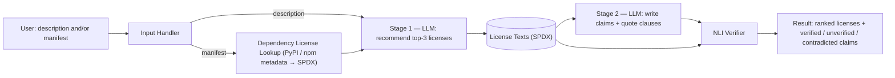

# Software Licensing Explainability with LLMs — v1

**ENSF 621 — Simplified Design (v1)**

v1 is a deliberately small version of the full design in [overview.md](overview.md). It keeps the core idea (recommend a license and explain it faithfully) and cuts the pipeline down to **two models: an LLM and an NLI model**. Everything else (retrieval, rules engine, repo scanning, fine-tuned classifier) moves to v2.

## 1. Objectives

**Primary objective:** build and evaluate a two-stage LLM + NLI pipeline that takes a project description or a dependency manifest, recommends suitable open-source licenses, and explains each recommendation with claims that are automatically checked against the license text.

- **O1: Understand the input.** Accept either a free-text project description or a dependency manifest (`requirements.txt`, `package.json`), and turn it into what the developer needs from a license.
- **O2: Recommend licenses.** Use an LLM to produce a ranked shortlist (top 3) of licenses that fit the description and are compatible with the dependencies.
- **O3: Explain with evidence.** For each recommendation, the LLM writes short claims, each paired with a quoted clause from the official license text.
- **O4: Verify every claim.** Use an NLI model to check that each quoted clause actually supports its claim, and label claims as *verified*, *unverified*, or *contradicted*.
- **O5: Evaluate without domain experts.** Measure recommendation correctness and explanation faithfulness using public, machine-readable license data as ground truth.

### Research questions

- **RQ1:** How often does an LLM recommend licenses that actually satisfy the stated requirements and dependency constraints?
- **RQ2:** How often do LLM license explanations contain claims that the license text does not support?
- **RQ3:** How much does NLI verification reduce unsupported claims, and how reliable is the NLI model as a verifier for legal text?

## 2. Scope

### Problem statement

> Given either a developer's natural-language project description or a dependency manifest, recommend up to three open-source licenses and explain each one with claims that are verified against the license text.

### In scope

- **Input:** one of the following:
  - a free-text description (e.g., "I'm building a SaaS library and want improvements to come back to the community")
  - a manifest file: `requirements.txt` (Python) or `package.json` (npm)
  - both at once is allowed; the manifest adds dependency constraints to the description.
- **Licenses:** the OSI-approved software licenses listed on choosealicense.com (~40), identified by SPDX IDs.
- **Dependency licenses:** read from registry metadata (PyPI JSON API, npm registry) and normalized to SPDX IDs. Unknown or missing licenses are flagged, not guessed.
- **Output:** up to three ranked licenses, each with verified claims and any compatibility warnings.

### Out of scope for v1 (planned for v2)

- Retrieval (RAG), vector store, and rerankers
- A deterministic rules engine or compatibility matrix inside the pipeline (the OSADL matrix is still used for **evaluation**)
- Scanning a whole repository by URL, or detecting licenses from source files (ScanCode)
- Fine-tuned clause classifiers
- CLI / GitHub Action
- Legal advice, non-software licenses, and jurisdiction-specific interpretation (out of scope in every version)

### Location of the problem

- **Jurisdiction:** jurisdiction-neutral. The tool explains what the license text says, not how courts in a given country interpret it.
- **Workflow point:** when a developer is choosing a license for a new project, or checking one against the dependencies they already use.

## 3. System Design

### 3.1 Software Architecture



**Components:**

1. **Input Handler:** accepts the description and/or manifest file and validates it.
2. **Dependency License Lookup** (manifest only, not ML): parses the manifest, queries PyPI/npm for each package's declared license, and maps it to an SPDX ID. Packages with no or ambiguous license info are marked *unknown*.
3. **Stage 1: Recommendation (LLM):** given the description and the list of dependency licenses, the LLM returns a structured JSON answer: the developer's inferred requirements, the top-3 licenses with a short reason each, and any dependency conflicts it sees.
4. **License Texts:** the official SPDX full texts of the recommended licenses (and of the dependency licenses involved in any conflict). This is a plain file lookup, not a vector database.
5. **Stage 2: Explanation (LLM):** given the license texts, the LLM writes 3–5 plain-language claims per license. Each claim must include a **verbatim quote** from the license text as evidence.
6. **NLI Verifier:** for each (quote, claim) pair:
   - **Quote check:** confirm the quote appears verbatim in the SPDX text. If it doesn't, the claim is *unverified*.
   - **Entailment check:** run the NLI model with the quote as premise and the claim as hypothesis. Entailment → *verified*; contradiction → *contradicted*; neutral → *unverified*.
   - If too many claims fail, Stage 2 is re-run once with the failed claims pointed out.
7. **Result:** ranked licenses with each claim labelled, plus warnings for unknown dependency licenses and possible conflicts.

**Why two LLM stages?** Splitting "pick licenses" from "explain them" means the LLM only sees the full text of the 3 licenses it chose, which keeps prompts short and gives it exact text to quote from.

**Tech stack:** Python, an LLM API (or a local open-weight model), Hugging Face Transformers for NLI, SPDX license-list-data (JSON), and Streamlit for the UI.

### 3.2 Machine Learning Models

**M1: Large Language Model**
- **Role:** interprets the description, infers requirements, recommends the top 3 licenses (Stage 1), and writes claims with quoted evidence (Stage 2).
- **Why it's useful:** mapping vague intent ("I don't want big companies taking my code without giving back") to license concepts such as copyleft or network clauses requires language understanding that rules can't provide. It also turns legal text into readable explanations.
- **Candidates:** a hosted model (e.g., Claude Sonnet 5) and one open-weight model (e.g., Llama or Qwen, 7–8B), so the two can be compared.
- **Output format:** schema-constrained JSON so every stage can be parsed and evaluated automatically.

**M2: Natural Language Inference (NLI) Model**
- **Role:** checks whether each quoted license clause entails the claim the LLM made about it.
- **Why it's useful:** it is an independent check that doesn't share the LLM's mistakes. It catches claims the license text doesn't support, and it doubles as an automatic faithfulness metric for evaluation, which matters because we have no legal expert.
- **Candidates:** `DeBERTa-v3-large-mnli` (primary), `roberta-large-mnli` (comparison).

## 4. Evaluation

All ground truth comes from public, curated sources.

| What we measure | How we get ground truth | Metrics |
|---|---|---|
| **Recommendation from a description** (RQ1) | Build requirement profiles from choosealicense.com's permission/condition/limitation labels. The correct answer set is every license whose labels match the profile. An LLM writes natural-language descriptions for each profile; the team spot-checks a sample. | Hit@1, Hit@3, % of recommendations that violate a stated requirement |
| **Recommendation from a manifest** (RQ1) | Real dependency sets from PyPI/npm packages. Correct answers are licenses the OSADL compatibility matrix marks compatible with every dependency. | % incompatible recommendations, % conflicts correctly flagged |
| **Explanation faithfulness** (RQ2) | The SPDX license text itself | % quotes found verbatim, % claims entailed, % contradicted |
| **Effect of the verifier** (RQ3) | Compare LLM-only output with LLM + NLI output | Reduction in unsupported claims shown to the user |
| **Reliability of the NLI verifier** (RQ3) | ~100–150 claim/clause pairs hand-labelled by the team, plus **auto-generated negatives**: true claims derived from choosealicense labels (e.g., "you must disclose source") and their negations (e.g., "you do not need to disclose source") paired with the relevant clause | Precision, recall, and F1 of the NLI model against the labels |

**Baselines:**
- LLM-only (Stage 1 + Stage 2, no verifier)
- Hosted LLM vs open-weight LLM, both with the verifier

**Human check (small):** 10–15 classmates rate explanation clarity and answer a few comprehension questions ("Can you use this in closed-source software?"), scored against the choosealicense labels.

## 5. User Interface (v1)

A single-page **Streamlit** app.

- **Input panel:** two tabs, *Describe your project* (text box) and *Upload manifest* (file upload for `requirements.txt` or `package.json`). Both can be filled in.
- **Dependency list** (if a manifest was uploaded): each package with its license and a status: compatible, unknown, or possible conflict.
- **Result cards:** one card per recommended license, showing:
  - rank and a one-line reason
  - claims, each with a badge: ✅ verified, ⚠️ unverified, ❌ contradicted
  - an expandable "evidence" section with the quoted clause
- **Footer:** "Explanations are based on license text only. This is not legal advice."

```
┌─────────────────────────────────────────────────────────┐
│ [ Describe your project ] [ Upload manifest ]           │
│ ┌─────────────────────────────────────────────────────┐ │
│ │ SaaS analytics library; improvements should come    │ │
│ │ back to the community.                              │ │
│ └─────────────────────────────────────────────────────┘ │
│                                        [ Recommend ]    │
├─────────────────────────────────────────────────────────┤
│ 1. AGPL-3.0 — covers use over a network                 │
│    ✅ Network users must be offered the source  ▸ quote │
│    ✅ Modified versions must stay AGPL-3.0      ▸ quote │
│    ⚠️ Compatible with all your dependencies            │
│ 2. GPL-3.0 — strong copyleft, no network clause         │
│ 3. MPL-2.0 — file-level copyleft                        │
├─────────────────────────────────────────────────────────┤
│ Based on license text only. Not legal advice.           │
└─────────────────────────────────────────────────────────┘
```

## 6. v1 → v2

| v1 (this document) | v2 ([overview.md](overview.md)) |
|---|---|
| LLM picks licenses | Deterministic rules engine + OSADL matrix decide the facts; LLM explains |
| Full text of 3 licenses passed to the LLM | Retrieval (embeddings + reranker) over clause chunks |
| Registry metadata for dependency licenses | ScanCode detection, repo URL scanning |
| NLI verifier only | NLI verifier + fine-tuned clause classifier for modified/unknown licenses |
| Streamlit page | Full web app + CLI / GitHub Action |

v1's evaluation results (especially how often the LLM alone picks incompatible licenses) show whether the v2 rules engine is worth building.
